# bevy_radiance_cascades

Diffuse global illumination for Bevy 0.20 without ray tracing hardware and
without noise.

It implements Alexander Sannikov's radiance cascades in the screen-space form
shown in [Rendering Path of Exile 2](https://www.youtube.com/watch?v=TrHHTQqmAaM),
plus a world-space cache so that light and occluders do not vanish when they
leave the screen.

## In a game

Five rooms of `h4ck`, a Bevy game this was written for and is tested in. Each
is lit by a few lamps and many small glowing strips, panels and pools. Left:
the game's rasterized lighting with a flat fill light standing in for bounced
light. Middle: the same view with the fill replaced by radiance cascades
(screen space and world cache, DLAA at 1080p). Third column: the same view
with the game's ray-traced lighting, Bevy Solari denoised by DLSS Ray
Reconstruction, which replaces the lamps' direct light as well as the bounce.

| Off | On | Ray traced |
| --- | --- | --- |
| 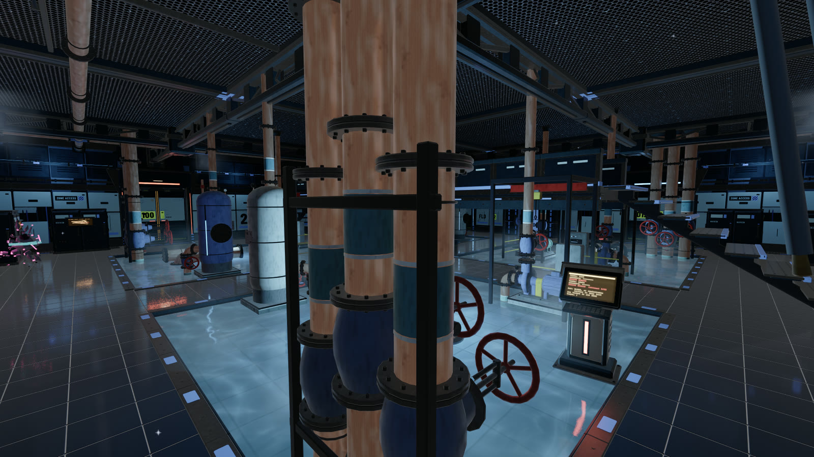 | 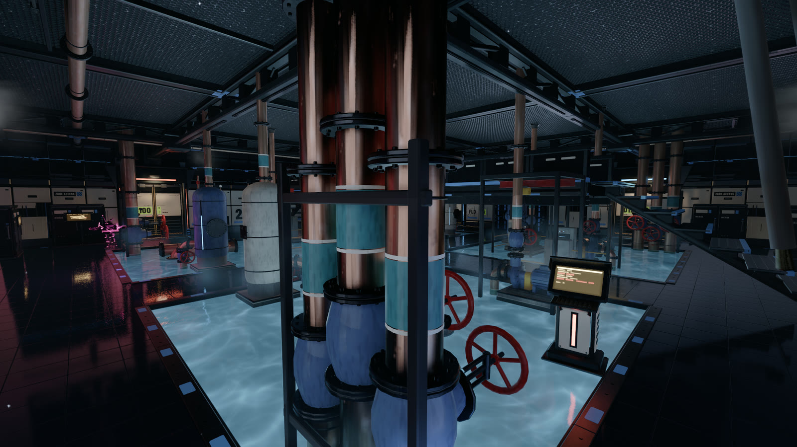 | 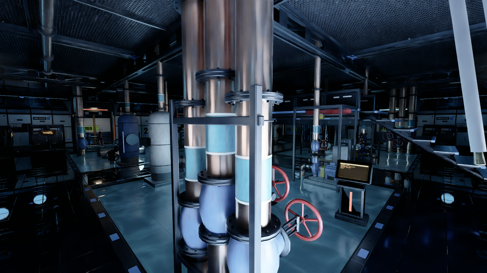 |
| 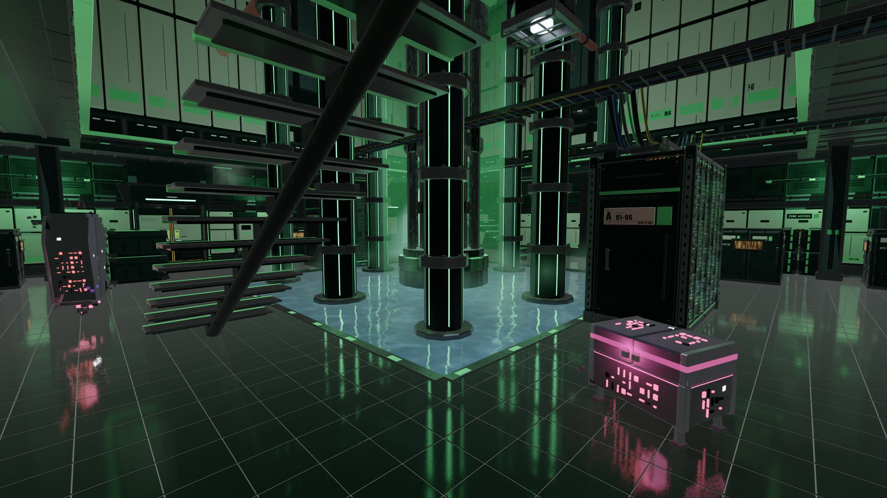 | 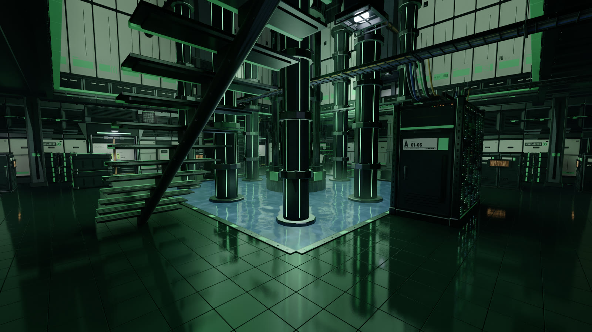 | 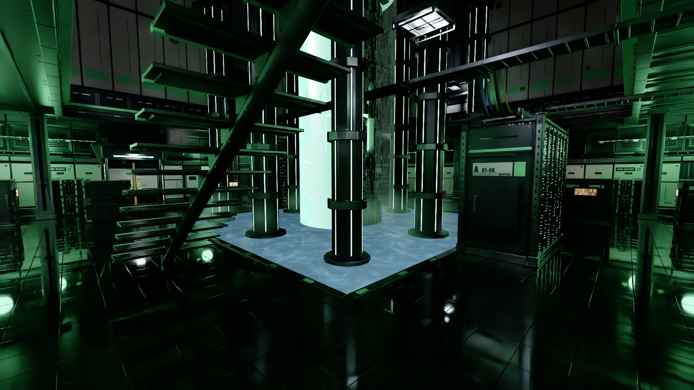 |
| 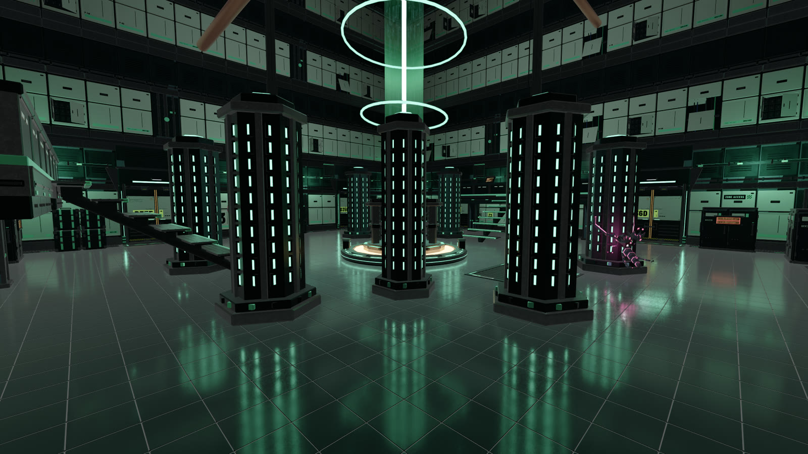 | 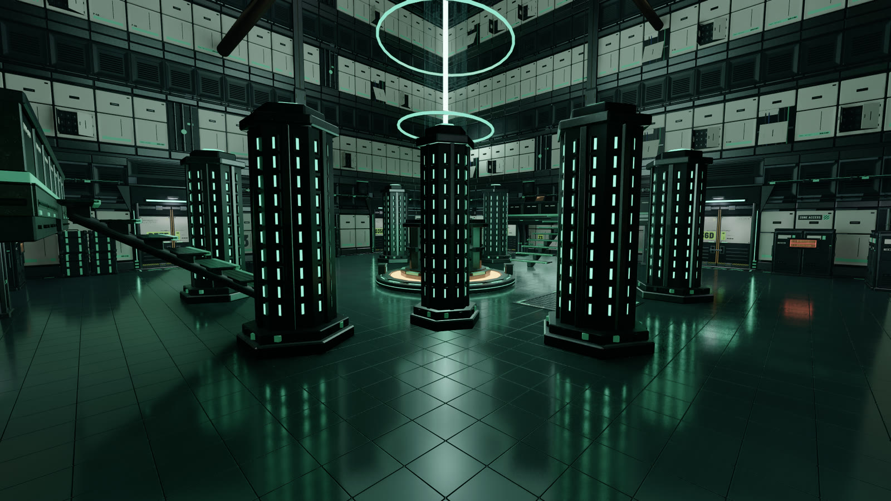 | 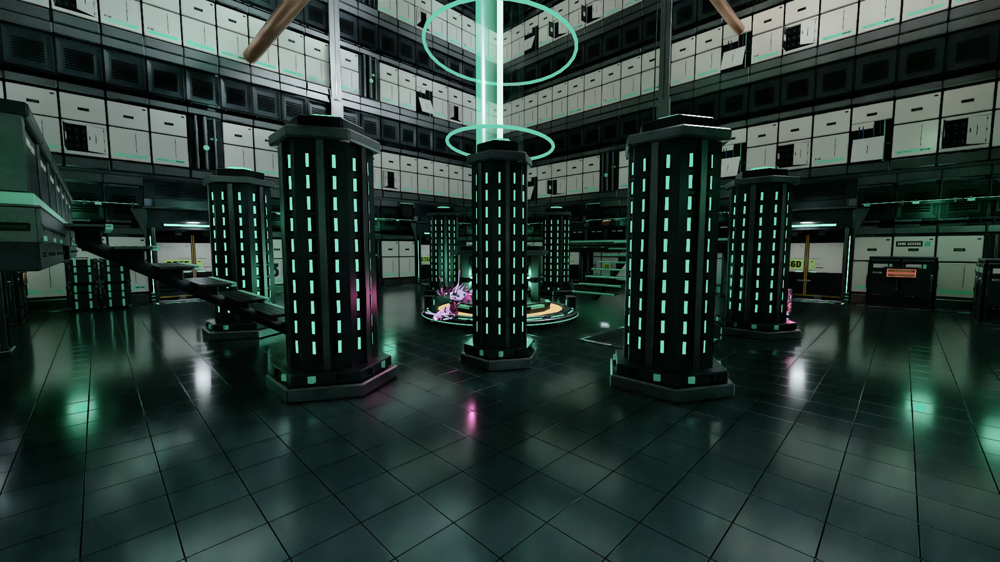 |
| 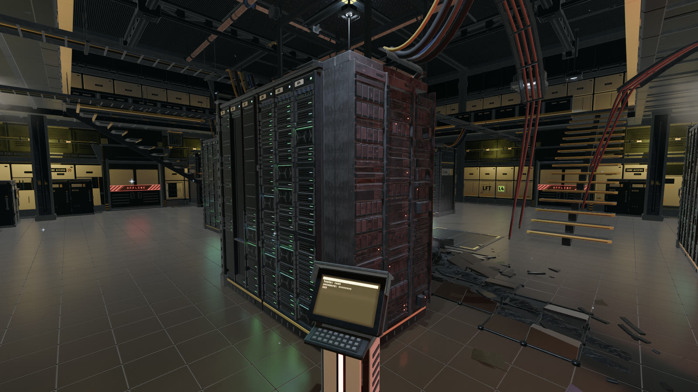 | 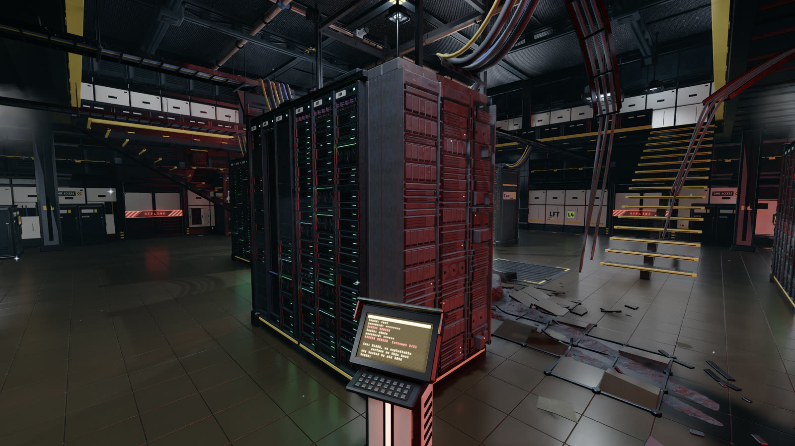 | 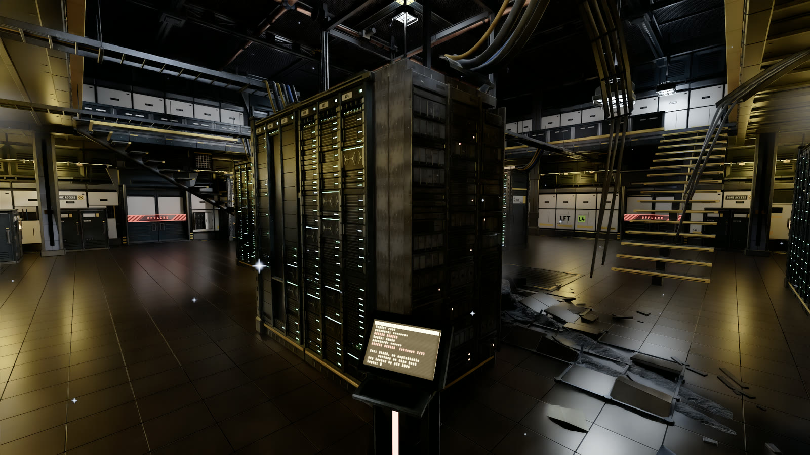 |
| 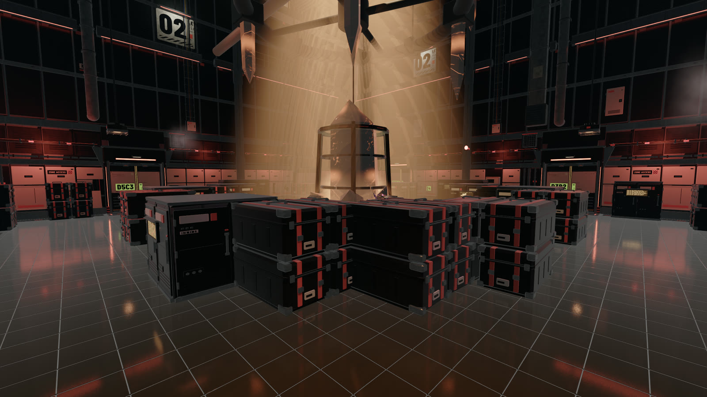 | 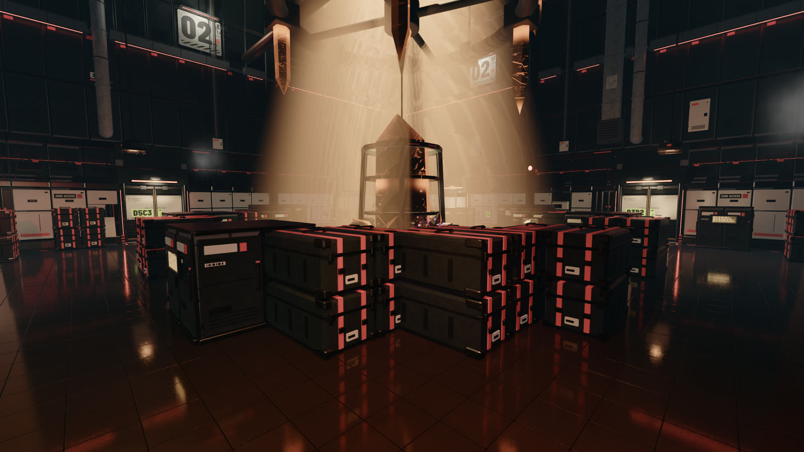 | 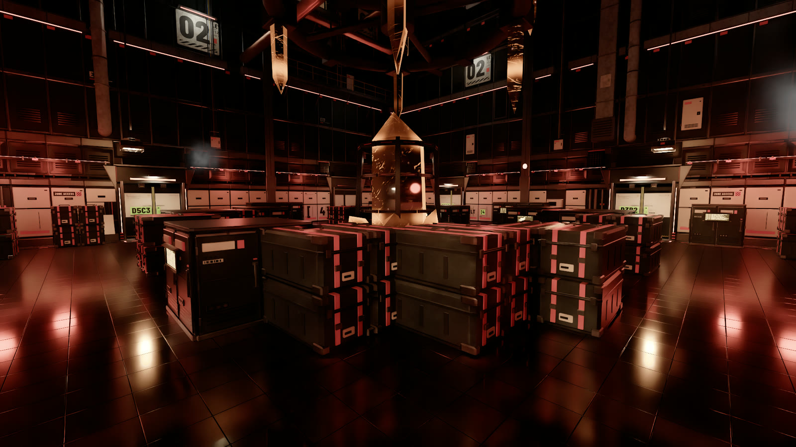 |

In the pump room the lit coolant pool is what lights the floor, the pipes and
the ceiling over it, and the pipe in the foreground, which no lamp reaches, is
dark on the side turned away from the pool. In the room of cooling columns the
pink screens of the two machines tint the floor beside them. In the vault the
shaft of lamp light bounces off the crates into the floor around them. None of
these glows is a light source as far as the engine knows: they are emissive
materials, and the cascades are what makes them cast light.

Where little light reaches, the result is darker than a flat fill, which lights
everything alike. (The machines moved between the captures, and the
vault's shaft of light through the haze does not show in the ray-traced one.)

```rust
use bevy::prelude::*;
use bevy_radiance_cascades::{RadianceCascades, RadianceCascadesPlugin};

App::new()
    .add_plugins((DefaultPlugins, RadianceCascadesPlugin))
    // The cascades are the ambient light now.
    .insert_resource(GlobalAmbientLight { brightness: 0.0, ..default() });

commands.spawn((Camera3d::default(), Msaa::Off, RadianceCascades::default()));
```

`cargo run --example room` shows a closed room lit by one spot light and one
glowing bar. `Space` toggles the cascades, `D` cycles the debug views.

`cargo run --example cornell` is a Cornell box lit only by a glowing panel,
and with `RC_MODE=reference` the same box path traced (Bevy Solari's reference
path tracer). `python cornell.py <name> [RC_...=value]` renders both and prints
how bright the cascades are against the path tracer, region by region; with
`RC_BOUNCE=0`, against the panel's direct light worked out exactly.

## How it works

Every frame, after the opaque pass:

1. **Probes on the depth buffer.** Cascade `n` has a probe every
   `probe_spacing * 2^n` pixels, and each probe has `(base_resolution * 2^n)^2`
   directions. So every cascade has the same number of rays: near light is
   sampled from many places in few directions, far light from few places in
   many directions.
2. **Each cascade traces one interval.** Cascade `n` only covers the distances
   its angular resolution can resolve. Rays are traced exactly against a depth
   pyramid (no stepping over thin occluders), and read what they hit from a
   prefiltered copy of the lit scene, sized to the cone each ray stands for.
3. **Rays the screen cannot answer go to the world cache.** A ray that leaves
   the screen, or passes behind something, continues through a clipmap of voxels
   around the camera that remembers every lit surface the camera has seen.
4. **Merge, top down.** A ray that found nothing in its interval continues with
   the radiance of the cascade above, interpolated between the surrounding
   probes. Cascade 0 ends up with the complete radiance field.
5. **Gather and add.** Each pixel integrates cascade 0 over its hemisphere and
   the result, times the surface's diffuse color, is added to the scene. It is
   also what surfaces re-emit next frame, so bounces accumulate.

Nothing is traced at random, so there is no sampling noise to denoise. What
does change from frame to frame is the view itself, when it is jittered for TAA
or DLSS: small lights are drawn differently every frame. So the light each
pixel receives is averaged with its neighbours on the same surface and blended
over a few frames (`temporal_blend`, reprojected with motion vectors where the
camera has them); set it to 1 to show every frame as traced. What has
accumulated is held within reach of the light of the last few frames, so a
light that goes out is gone in about five frames, and a frame that is far
brighter than what came before it is taken for a stray sample and held back.

## Settings

All on the `RadianceCascades` component; see its docs for detail.

| Field | Default | |
| --- | --- | --- |
| `probe_spacing` | 4 | Pixels between the finest probes. Cost per cascade is `(base_resolution / probe_spacing)^2` rays per pixel. |
| `base_resolution` | 4 | Directions across the finest probes' maps (16 directions). |
| `cascade_count` | 4 | The last cascade always reaches to the edge of the screen. More resolve far light into finer directions, but from probes twice as far apart each: past four, measured against a path tracer, they lose light and smear shadows. |
| `interval_length` | 2 | Length of the finest rays in probe spacings. Longer is steadier under camera motion. |
| `thickness` | 0.5 | How thick, in world units, on-screen surfaces are assumed to be. |
| `bounce` | 1 | 1 for physically correct multiple bounces, 0 for one. |
| `temporal_blend` | 0.1 | How much of each frame's light shows. Lower is steadier under TAA/DLSS jitter, slower to follow changing lights; 1 is no accumulation. |
| `ambient_occlusion` | 1 | How much of the camera's `ScreenSpaceAmbientOcclusion`, if it has one, darkens the indirect light in creases and contacts the probes are too coarse for. |
| `specular` | 1 | How much of the arriving light a surface's specular side reflects to the eye. Metals have no diffuse side: without it the bounced light does not show on them. |
| `specular_roughness` | 0.3..0.6 | The perceptual roughness over which `specular` fades in. Smoother surfaces are left to screen-space reflections. |
| `specular_separate` | false | Keep what each pixel mirrors out of the image, in `RadianceCascadesResources::specular`, for a reflection pass of your own to combine with. If that pass runs before the cascades (screen-space reflections do), don't hand it the texture, which is last frame's by then: put a `RadianceCascadesSpecularCover` on the view in the render world, a texture whose alpha says how much of each pixel's reflection the pass found, and the cascades add the rest themselves. |
| `emissive_scale`, `emissive_unexposed` | 1, off | For a Bevy fork that stores the G-buffer's emissive scaled or without the exposure applied. |
| `ambient` | 0 | A uniform light arriving at every surface, in lux, bounced like any other: an ambient fill. |
| `amortize_far` | on | Traces the far cascades every second or fourth frame instead of every one. Far light is a few frames late; the cost falls by about a third. |
| `sky_color`, `sky_brightness` | white, 80 | What rays that escape everything see. Set the brightness to 0 indoors. |
| `world_cache` | on | `None` for purely screen-space lighting. |
| `debug` | off | `Indirect`, `Irradiance`, `Surfaces` (what the cascades know of the scene), `WorldCache`. |

## Lamps the camera has not seen

The cascades light the scene with what is on screen and what the world cache
remembers. A lamp that has never been in view lights nothing until it is, and
one in view lights only as bright as it is drawn. Put a `RadianceEmitter` on a
lamp's lit face to hand it to the cascades outright:

```rust
commands.spawn((
    Mesh3d(face),
    MeshMaterial3d(glowing),
    RadianceEmitter {
        radiance: LinearRgba::rgb(40_000.0, 40_000.0, 36_000.0), // cd/m^2
        area: 0.36,
        normal: Some(Dir3::NEG_Y),
        range: 30.0,
        clearance: 0.3,
        // The room it hangs in, relative to it: its light stays inside.
        bounds: Some((Vec3::new(-4.0, -3.0, -4.0), Vec3::new(4.0, 0.5, 4.0))),
    },
));
```

It lights like a flat emissive surface of that luminance and area, from
wherever it is, and the mesh's own glow can be whatever looks right on screen.
The 64 nearest the camera count. What stands between an emitter and a surface
is known only where the camera has looked, so give each its room as `bounds`,
or it lights the next room through a wall nobody has seen yet.

## Cost

Measured in a real game scene (an interior of `h4ck`) on an RTX 5090, rendering
1280x720 upscaled to 2560x1440 with DLSS, world cache on, 8 levels of 128
voxels: 0.9 to 1.0 ms at the default `probe_spacing` of 4, 1.7 to 2.1 ms at 2.
Other hardware has not been measured. The cost does not depend on the number
of lights or emissive surfaces. With `RenderDiagnosticsPlugin`, each stage
reports its own GPU time (`rc_pyramids`, `rc_voxels`, `rc_cascade_NN`,
`rc_gather`, `rc_resolve`).

## Requirements and limitations

* The camera needs `Hdr`, `DeferredPrepass`, `DepthPrepass` (all inserted
  automatically) and `Msaa::Off`. The plugin makes deferred the default opaque
  render method.
* **Diffuse only.** Specular reflections still come from whatever you use for
  them. An `EnvironmentMapLight` adds its own diffuse light on top.
* **Only deferred materials receive indirect light.** Meshes drawn forward
  still occlude and bounce light, but there is no albedo to light them with. The
  `Surfaces` debug view shows which is which. Transparent meshes are ignored.
* **The world cache only knows what has been on screen.** Light sources the
  camera has never looked at contribute nothing until it does, and what it
  remembers of places it no longer sees is as they were when last seen.
* Voxels of the world cache are 12.5 cm by default: thinner walls can leak
  remembered light.
* Perspective projections only, and the camera's viewport must start at the
  origin of its render target.
* Exposure changes are handled, but the cache is not shared between cameras.
* **It is darker than a path tracer.** In the `cornell` example at the
  defaults, the light a glowing panel sends straight to the surfaces in view
  comes to 0.96 of the exact figure (13% mean error); with all its bounces the
  image is 0.80 as bright as the path-traced one. Light bounced from what is
  off screen, which only the world cache knows, is weaker still: a ceiling lit
  by a floor out of view gets about a third of what it should. A
  `RadianceEmitter` on its own delivers about 0.73 of an emissive surface of
  its luminance and area.
* Work in progress: stability under camera motion and the cost of the gather
  are being worked on.

## License

MIT or Apache 2.0, at your option. See `LICENSE-MIT` and `LICENSE-APACHE`.
