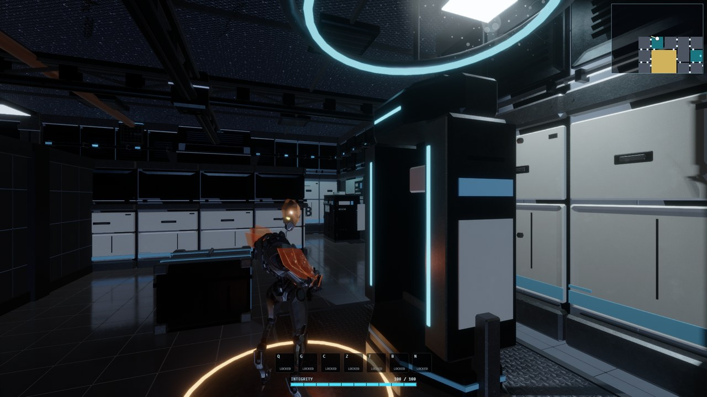
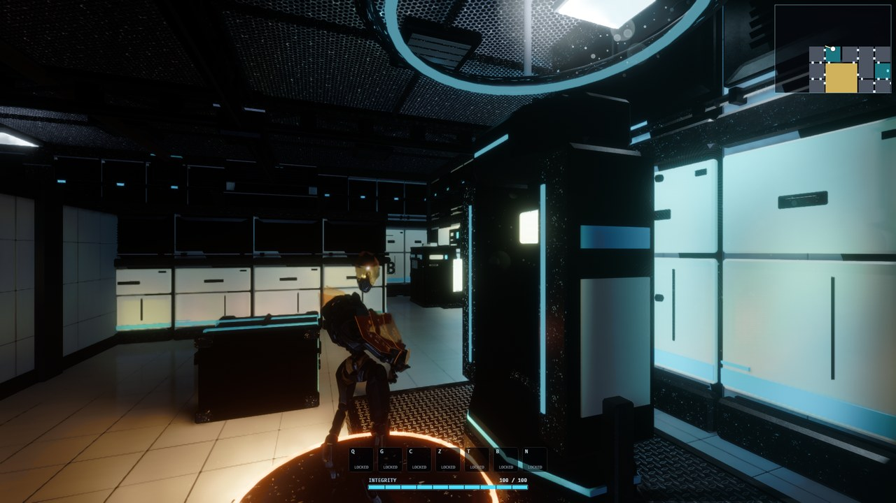
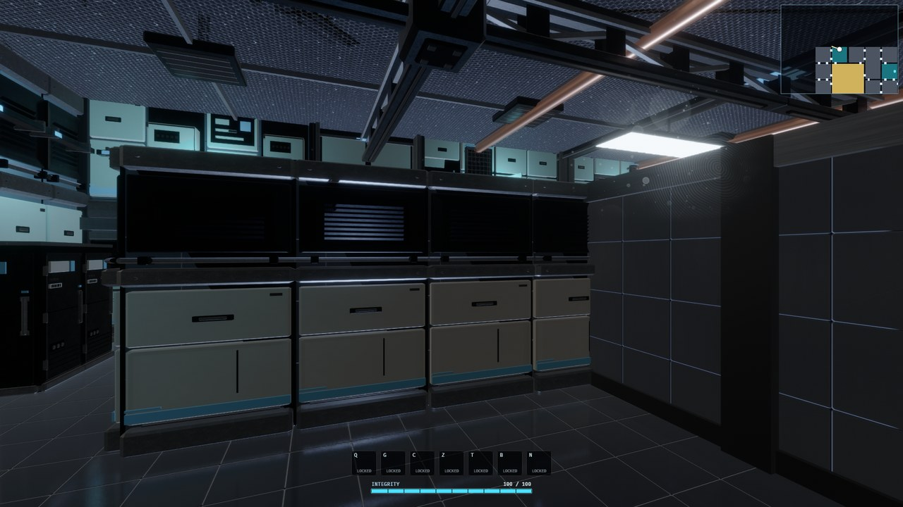
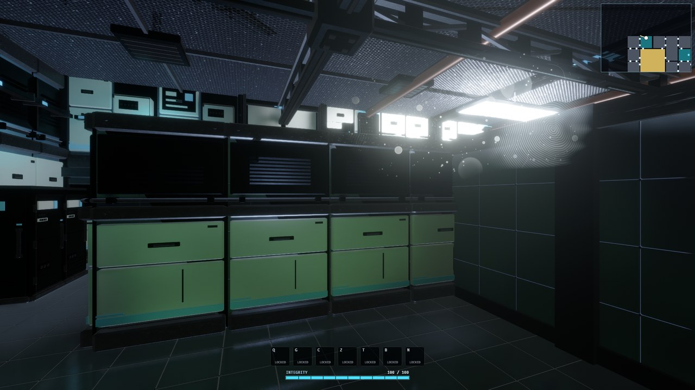

# bevy_radiance_cascades

Diffuse global illumination for Bevy 0.20 without ray tracing hardware and
without noise.

It implements Alexander Sannikov's radiance cascades in the screen-space form
shown in [Rendering Path of Exile 2](https://www.youtube.com/watch?v=TrHHTQqmAaM),
plus a world-space cache so that light and occluders do not vanish when they
leave the screen.

## In a game

Two rooms of `h4ck`, a Bevy game this was written for and is tested in. Both
are lit by a few lamps and many small glowing strips and panels. Left: the
game's rasterized lighting with a flat fill light standing in for bounced
light. Right: the same frame with the fill replaced by radiance cascades
(screen space and world cache, default settings, DLSS quality at 1080p).

| Off | On |
| --- | --- |
|  |  |
|  |  |

In room A the glowing ring under the machine lights the floor around it and
the cyan strips light the cabinets beside them. In room B the lamp's light
bounces off the cabinets and the floor into the parts of the room it does not
reach. None of these glows is a light source as far as the engine knows: they
are emissive materials, and the cascades are what makes them cast light.

Where little light reaches, the result is darker than a flat fill, which lights
everything alike.

```rust
use bevy::prelude::*;
use bevy_radiance_cascades::{RadianceCascades, RadianceCascadesPlugin};

App::new()
    .add_plugins((DefaultPlugins, RadianceCascadesPlugin))
    // The cascades are the ambient light now.
    .insert_resource(GlobalAmbientLight { brightness: 0.0, ..default() });

commands.spawn((Camera3d::default(), Msaa::Off, RadianceCascades::default()));
```

`cargo run --example room` shows a closed room lit by one spot light and one
glowing bar. `Space` toggles the cascades, `D` cycles the debug views.

## How it works

Every frame, after the opaque pass:

1. **Probes on the depth buffer.** Cascade `n` has a probe every
   `probe_spacing * 2^n` pixels, and each probe has `(base_resolution * 2^n)^2`
   directions. So every cascade has the same number of rays: near light is
   sampled from many places in few directions, far light from few places in
   many directions.
2. **Each cascade traces one interval.** Cascade `n` only covers the distances
   its angular resolution can resolve. Rays are traced exactly against a depth
   pyramid (no stepping over thin occluders), and read what they hit from a
   prefiltered copy of the lit scene, sized to the cone each ray stands for.
3. **Rays the screen cannot answer go to the world cache.** A ray that leaves
   the screen, or passes behind something, continues through a clipmap of voxels
   around the camera that remembers every lit surface the camera has seen.
4. **Merge, top down.** A ray that found nothing in its interval continues with
   the radiance of the cascade above, interpolated between the surrounding
   probes. Cascade 0 ends up with the complete radiance field.
5. **Gather and add.** Each pixel integrates cascade 0 over its hemisphere and
   the result, times the surface's diffuse color, is added to the scene. It is
   also what surfaces re-emit next frame, so bounces accumulate.

Nothing is traced at random, so there is no sampling noise to denoise. What
does change from frame to frame is the view itself, when it is jittered for TAA
or DLSS: small lights are drawn differently every frame. So the light each
pixel receives is averaged with its neighbours on the same surface and blended
over a few frames (`temporal_blend`, reprojected with motion vectors where the
camera has them); set it to 1 to show every frame as traced.

## Settings

All on the `RadianceCascades` component; see its docs for detail.

| Field | Default | |
| --- | --- | --- |
| `probe_spacing` | 4 | Pixels between the finest probes. Cost per cascade is `(base_resolution / probe_spacing)^2` rays per pixel. |
| `base_resolution` | 4 | Directions across the finest probes' maps (16 directions). |
| `cascade_count` | 6 | The last cascade always reaches to the edge of the screen. |
| `interval_length` | 2 | Length of the finest rays in probe spacings. Longer is steadier under camera motion. |
| `thickness` | 0.5 | How thick, in world units, on-screen surfaces are assumed to be. |
| `bounce` | 1 | 1 for physically correct multiple bounces, 0 for one. |
| `temporal_blend` | 0.1 | How much of each frame's light shows. Lower is steadier under TAA/DLSS jitter, slower to follow changing lights; 1 is no accumulation. |
| `ambient_occlusion` | 1 | How much of the camera's `ScreenSpaceAmbientOcclusion`, if it has one, darkens the indirect light in creases and contacts the probes are too coarse for. |
| `sky_color`, `sky_brightness` | white, 80 | What rays that escape everything see. Set the brightness to 0 indoors. |
| `world_cache` | on | `None` for purely screen-space lighting. |
| `debug` | off | `Indirect`, `Irradiance`, `Surfaces` (what the cascades know of the scene), `WorldCache`. |

## Cost

Measured in a real game scene on an RTX 5090 at 2560x1440, at an earlier
revision: 1.7 ms screen-space only, 3.4 ms with the world cache. It has not
been measured again since the world cache's ray tracing and the resolve pass
changed. The cost does not depend on the number of lights or emissive
surfaces. With `RenderDiagnosticsPlugin`, each stage reports its own GPU time
(`rc_pyramids`, `rc_voxels`, `rc_cascade_NN`, `rc_gather`, `rc_resolve`).

## Requirements and limitations

* The camera needs `Hdr`, `DeferredPrepass`, `DepthPrepass` (all inserted
  automatically) and `Msaa::Off`. The plugin makes deferred the default opaque
  render method.
* **Diffuse only.** Specular reflections still come from whatever you use for
  them. An `EnvironmentMapLight` adds its own diffuse light on top.
* **Only deferred materials receive indirect light.** Meshes drawn forward
  still occlude and bounce light, but there is no albedo to light them with. The
  `Surfaces` debug view shows which is which. Transparent meshes are ignored.
* **The world cache only knows what has been on screen.** Light sources the
  camera has never looked at contribute nothing until it does, and what it
  remembers of places it no longer sees is as they were when last seen.
* Voxels of the world cache are 12.5 cm by default: thinner walls can leak
  remembered light.
* Perspective projections only, and the camera's viewport must start at the
  origin of its render target.
* Exposure changes are handled, but the cache is not shared between cameras.
* Work in progress: stability under camera motion and the cost of the gather
  are being worked on.
